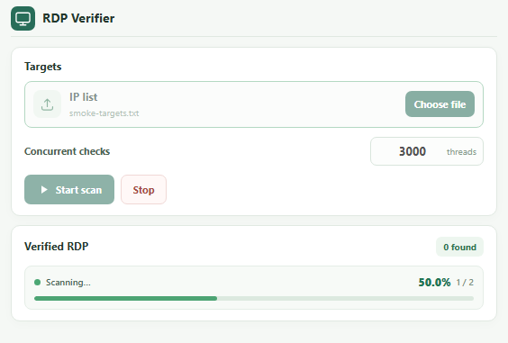

# RDP Verifier

RDP Verifier یک ابزار ویندوزی با رابط کوچک است که فهرست IP و پورت را بررسی می‌کند و پس از پایان، فقط مقصدهای تأییدشده را در یک فایل متنی روی دسکتاپ می‌نویسد.

RDP Verifier is a portable Windows desktop app for checking whether an IPv4 endpoint repeatedly responds as an RDP service and reaches an NLA/CredSSP authentication challenge quickly. It shows a progress bar and counts; the completed result list is written to a TXT file on the Desktop.



## Download and run

1. Download `RDP-Verifier-Windows.zip` from the repository's **Releases** page.
2. Extract the entire ZIP. Keep `RDP Verifier.exe` together with its `resources` directory and the other packaged files.
3. Run `RDP Verifier.exe`. The portable release does not require a separate Node.js installation.
4. Choose a local text file, set **Concurrent checks** from 1 to 3,000, and select **Start scan**.
5. Wait for **Scan complete** and **Saved to Desktop**. The output file is named `rdp-results-<UTC timestamp>-<scan id prefix>.txt`.

The window deliberately contains only file selection, concurrency, Start/Stop, progress, and the verified count. It does not display an activity log or individual IP addresses.

## Input file

Use UTF-8 text with one target per line. A `.txt` extension is optional.

```text
192.168.1.10:3389
192.168.1.11
192.168.1.20:3390
192.168.2.0/30:3389
192.168.3.10-192.168.3.15:3391
ip,port
192.168.4.1,3389
# this is a comment
192.168.4.2:3389 # inline comment
```

| Form | Meaning |
| --- | --- |
| `IPv4` | One address on default port 3389 |
| `IPv4:port` or `IPv4,port` | One address on the given port |
| `IPv4/prefix:port` | Every address in that CIDR block on the given port |
| `startIPv4-endIPv4:port` | Inclusive IPv4 range on the given port |

- Ports must be 1–65,535. If omitted, the port is 3389.
- Blank lines, `#` comments, and an `ip,port`, `host,port`, or `range,port` header are ignored. A UTF-8 BOM and CRLF line endings are accepted.
- Duplicate `IP:port` pairs are checked once. The same IP with two different ports is two targets.
- CIDR expansion includes all addresses in the block, including network and broadcast addresses.
- IPv6 addresses, hostnames, and DNS names are not supported.
- There is no fixed file-byte-size limit. The file is read into memory, and at most **1,000,000 distinct expanded targets** are accepted in one scan. A file can therefore still exceed available memory, and a single huge CIDR block can hit the target-count limit. Invalid lines report a line number.

## What “verified” means

Each target receives an initial credential-free probe. If it passes, the app waits **250 ms** and performs a second, independent probe. **Both** must pass. Each probe has its own end-to-end deadline of **3 seconds**, beginning with its TCP connection attempt. A probe passes only if all of these stages complete within its deadline:

1. A TCP connection opens to the specified port.
2. The server returns a valid RDP X.224 negotiation confirmation selecting CredSSP/NLA (`HYBRID` or `HYBRID_EX`).
3. A TLS handshake completes.
4. After a credential-free CredSSP/NTLM Type 1 negotiation message, the server returns a CredSSP response with a structurally valid NTLM Type 2 authentication challenge and no CredSSP error code. The TLS connection must then remain open without an error for a **300 ms observation period**; that period is part of the probe's 3-second deadline.

A merely open port, unrelated service, incomplete or malformed packet, stalled connection, failed TLS exchange, CredSSP error response, missing authentication challenge, or one-time transient response is excluded. The app sends **no username or password** and does not attempt to sign in.

This is a protocol-level check for a repeatably responsive RDP authentication path. Requiring two independent successful probes reduces transient and connection-stage false positives. It cannot prove that a graphical login window would appear in a particular RDP client, that credentials would be accepted, or that a desktop session would work. A service that emulates both protocol exchanges could still pass. Conversely, a working service can be omitted if it uses an unsupported older RDP security mode, a Kerberos-only path, or either probe takes longer than 3 seconds. TLS certificate identity is not validated; this accommodates common self-signed RDP certificates but does not authenticate the server's identity.

## Concurrency and progress

The **Concurrent checks** setting controls the maximum number of asynchronous network probes in flight, not the number of operating-system threads. The scanner starts up to the smaller of the selected value and the number of targets.

- **Total** is the count after range expansion and `IP:port` deduplication.
- **Checked** increases once per target, after its first failure or after both successful probes. A passing first probe alone does not increase the verified count.
- **Verified** counts targets that passed both independent protocol exchanges.
- The displayed percentage is `checked / total`, rounded to one decimal place. It stays below 100% until all targets finish.
- **Stop** aborts in-flight probes and stops scheduling new ones. Aborted probes are not counted as checked, so partial progress can remain below 100%.

Choosing 3,000 allows that many simultaneous probes, but actual throughput and timeout behavior depend on the machine and network resources. The app does not adapt the chosen concurrency automatically.

## Desktop output

After a scan finishes normally, the app writes a uniquely named `rdp-results-...txt` file to the Windows Desktop. Each line contains only `IPv4:port`; there is no header, error list, or scan log. Lines use CRLF endings. If no targets pass, the file is empty. A unique name prevents an earlier result file from being overwritten.

The app shows **Saving…** until the file write finishes. A save failure is shown in the window. Stopping a scan or closing the app before completion does not create a final result file.

## Architecture and privacy

- `main.cjs` starts the Electron window and obtains the current user's Desktop path.
- `server.mjs` serves the UI and scan API on a random `127.0.0.1` port, keeps one active scan, and writes the final TXT file.
- `public/` contains the minimal window and progress display. It asks the local API for counts only; individual result addresses are not rendered in the window.
- `src/targets.mjs` parses, expands, validates, and deduplicates input.
- `src/scan.mjs` runs the asynchronous worker pool and counts outcomes.
- `src/rdp.mjs` performs the RDP, TLS, and CredSSP probe.
- `test/` contains parser, protocol, scan, and local API tests.

The app code processes the selected file locally and sends probes directly to its listed endpoints. Its internal HTTP service binds only to loopback and checks Host and Origin headers. No account credentials are requested or transmitted. The released Electron runtime retains its bundled license notices.

## Build and test from source

The release ZIP is the simplest way to run the app. For development on Windows, use Node.js and npm:

```powershell
npm install
npm test
npm start
```

`npm start` opens the Electron app. To create the portable Windows ZIP from the checked-out source:

```powershell
npm run package:win
```

The package command writes `dist/RDP-Verifier-Windows.zip`. It uses the Electron version pinned by the project; keep the Electron runtime and its license files together when redistributing the ZIP.

## Troubleshooting

| Symptom | Check |
| --- | --- |
| File does not load | Use a readable, nonempty UTF-8 text file. The filename appears after loading; target syntax is checked when the scan starts. |
| Invalid input or target limit | Read the line-numbered error; check IPv4 format, port range, CIDR size, and the 1,000,000-target cap. |
| 0 verified | No target passed both required RDP/NLA/TLS/CredSSP exchanges, each within its own 3-second deadline. This alone does not prove every host is offline. |
| Scan stops below 100% | Stop cancels remaining work and does not save a final file. |
| No Desktop file after completion | Check the status message for a save error and verify that the scan reached **Scan complete**, not **Scan stopped**. |
